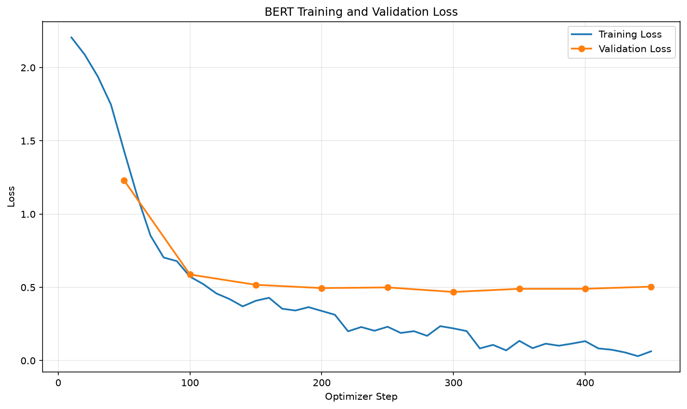
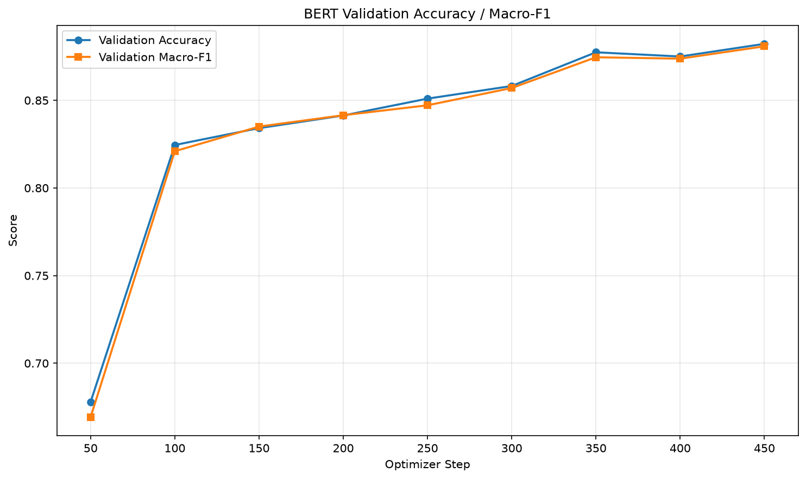

# 中文句子情緒分類（BERT 多元分類微調）

以 `google-bert/bert-base-chinese` 為基礎模型，微調成可以判斷 **8 種情緒語調** 的中文句子分類模型。
本作業修改自課堂範例 `bert_finetune`（二元分類：正面 / 負面），改為 **8 類多元分類**。

## 訓練資料來源
- [Datasets:Johnson8187/Chinese_Multi-Emotion_Dialogue_Dataset](https://huggingface.co/datasets/Johnson8187/Chinese_Multi-Emotion_Dialogue_Dataset)
  - 下載方式：在 `Files and versions` 下載 `data.csv`，放到 `data/data.csv`
  - 共 4,159 筆中文對話句子，欄位為 `text`（句子）與 `emotion`（情緒標籤）
  - 句子很短：平均約 20 字，最長 92 字

## 基礎模型
- [google-bert/bert-base-chinese](https://huggingface.co/google-bert/bert-base-chinese)

## 安裝套件
- Python 3.12.3
- torch (2.11.0+cu128)
- torchvision (0.26.0+cu128)
- torchaudio (2.11.0+cu128)
- transformers (5.20.2)
- datasets (5.1.0)
- evaluate (0.4.6)
- accelerate (1.15.0)
- scikit-learn (1.9.1)
- pandas (3.0.6)
- matplotlib (3.11.2)

安裝方式：

```bash
pip install -r requirements.txt
```

> 訓練環境：Windows 11、NVIDIA GeForce RTX 4060 (8GB)，啟用 FP16 混合精度，訓練約 2 分鐘。

## 說明

### 模型用途
輸入一句中文，模型會判斷這句話的 **情緒語調**，並輸出該類別的信心分數（softmax 機率）。
可用於聊天機器人、客服對話、社群留言等場景的情緒分析。

### 類別（label 轉換）
訓練資料的 `label` 是文字，但微調時只能使用整數，因此 `prepare_data.py` 會依照筆數由多到少，
把文字標籤轉成 `0 ~ 7` 的整數，對照表存在 `data/bert/label_map.json`，並寫入模型的 `config.json`（`id2label` / `label2id`），
所以推論時可以直接輸出中文標籤。

| id | 情緒 | 筆數 |
|:--:|:----:|----:|
| 0 | 平淡語氣 | 705 |
| 1 | 開心語調 | 592 |
| 2 | 關切語調 | 560 |
| 3 | 憤怒語調 | 527 |
| 4 | 驚奇語調 | 499 |
| 5 | 悲傷語調 | 486 |
| 6 | 厭惡語調 | 404 |
| 7 | 疑問語調 | 386 |

### 資料切分
使用分層抽樣（stratify），讓每份資料的類別比例相同：

| 資料集 | 筆數 | 用途 |
|:--|--:|:--|
| train | 3,327 (80%) | 訓練 |
| valid | 416 (10%) | 每 50 步驗證，選最佳模型、Early Stopping |
| test  | 416 (10%) | 訓練結束後評估最終成績 |

### 與二元分類範例的主要差異

| 項目 | 範例（二元分類） | 本作業（多元分類） |
|:--|:--|:--|
| `num_labels` | 2 | 8 |
| `id2label` / `label2id` | 寫死 NEGATIVE / POSITIVE | 從 `label_map.json` 讀取 |
| 評估指標 | binary F1 | Accuracy + Macro-F1 |
| `MAX_SEQ_LENGTH` | 512 | 128（句子都很短） |
| Learning rate | 1e-4 | 3e-5 |
| Epochs | 3 | 5（搭配 Early Stopping） |
| 輸出 | 只有 train / valid | 另外用 test set 產生 classification report |

### 訓練設定
- batch size 32、learning rate 3e-5、warmup 50 steps、weight decay 0.01、linear scheduler
- 每 50 steps 驗證一次，以 `eval_loss` 選擇最佳模型（`load_best_model_at_end=True`）
- `EarlyStoppingCallback(patience=3)`：eval_loss 連續 3 次沒改善就提前停止
- 實際在 step 450（約 4.3 epochs）提前停止，最佳模型為 **checkpoint-300**（eval_loss = 0.4687）
- `output/` 只放最佳模型，不包含 `checkpoint-*` 資料夾

### 作業指定句子的預測結果

```
我每天都能跟她一起上學，我好開心！ => 開心語調 (0.9881)
最好的朋友要離開臺灣了，以後可能不容易再見面... => 悲傷語調 (0.9785)
我覺得我快不行了... => 悲傷語調 (0.9849)
剛剛收到研究所錄取的通知書！ => 開心語調 (0.9753)
今年的冬天好像比較晚來。 => 平淡語氣 (0.9835)
```

## 執行方法

```bash
# 1. 資料前處理：文字 label → 整數 id，並切分 train / valid / test
python prepare_data.py

# 2. 微調 BERT，最佳模型存到 output/
python train_bert.py

# 3. 畫出訓練曲線，存到 images/
python plot_bert_metrics.py

# 4. 用微調後的模型預測作業指定的句子
python infer_bert.py
```

## 成果

### Test set 評估結果（416 筆）

**Accuracy 89.42%、Macro-F1 0.8938**

```
              precision    recall  f1-score   support

        平淡語氣     0.9508    0.8286    0.8855        70
        開心語調     0.8261    0.9661    0.8906        59
        關切語調     0.8615    1.0000    0.9256        56
        憤怒語調     0.9038    0.8868    0.8952        53
        驚奇語調     0.8889    0.8000    0.8421        50
        悲傷語調     0.9556    0.8776    0.9149        49
        厭惡語調     0.8837    0.9268    0.9048        41
        疑問語調     0.9167    0.8684    0.8919        38

    accuracy                         0.8942       416
   macro avg     0.8984    0.8943    0.8938       416
weighted avg     0.8985    0.8942    0.8936       416
```

### Training / Validation Loss


### Validation Accuracy / Macro-F1


## 專案結構

```
.
├── data/
│   ├── data.csv              # 原始資料集
│   └── bert/                 # prepare_data.py 輸出（train/valid/test.jsonl、label_map.json）
├── output/                   # 微調後的最佳模型（Best Model，Git LFS）
│   ├── config.json
│   ├── model.safetensors
│   ├── tokenizer.json
│   ├── tokenizer_config.json
│   ├── trainer_state.json
│   └── test_report.txt
├── images/                   # 訓練曲線圖
├── prepare_data.py
├── train_bert.py
├── plot_bert_metrics.py
├── infer_bert.py
├── requirements.txt
└── README.md
```

## 補充：上傳大型模型檔（Git LFS）
`model.safetensors` 約 390MB，超過 GitHub 單一檔案 100MB 的限制，因此使用 [Git LFS](https://git-lfs.com/) 管理：

```bash
git lfs install
git lfs track "*.safetensors" "*.bin"   # 產生 .gitattributes
git add .gitattributes
git add .
git commit -m "add fine-tuned model"
git push
```

## 補充：遇到的問題
- **transformers 5.x 移除了 `warmup_ratio`**：`TrainingArguments` 傳入 `warmup_ratio` 會出現 `TypeError`，改用 `warmup_steps=50`（約總步數的 10%）。
- **Windows 終端機中文亂碼**：`data.csv` 是 UTF-8 編碼，讀檔時指定 `encoding="utf-8"`，執行時可設定 `PYTHONIOENCODING=utf-8`。
